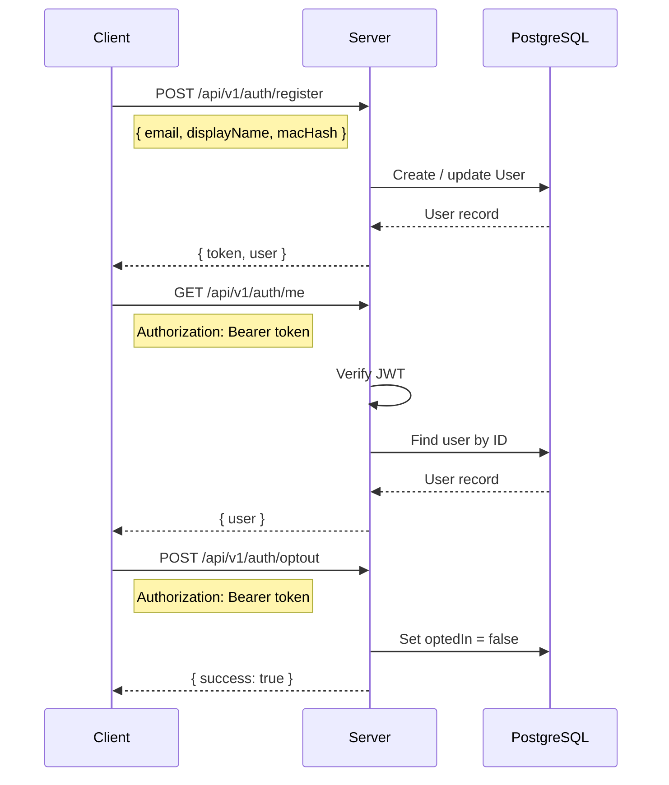
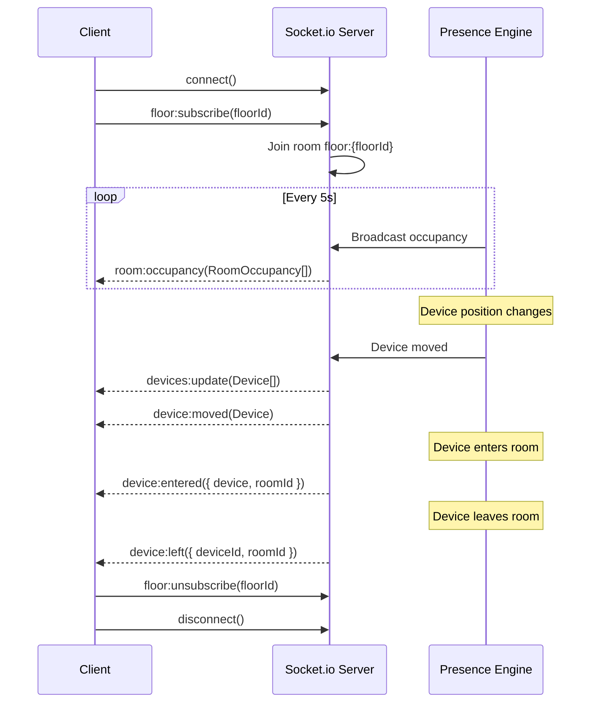
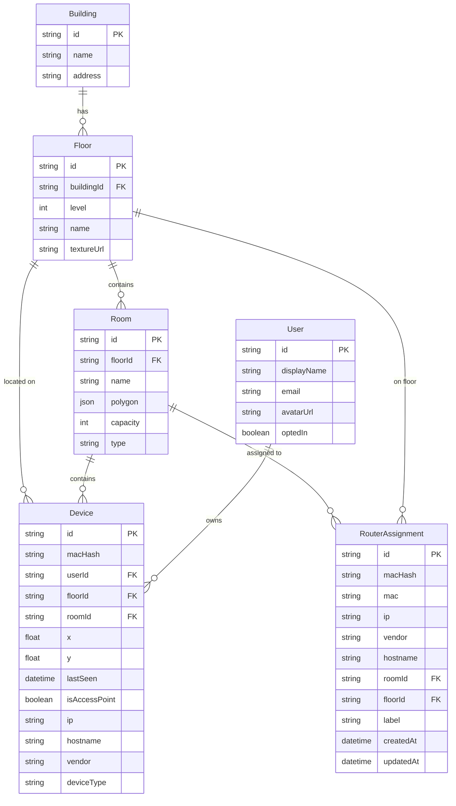
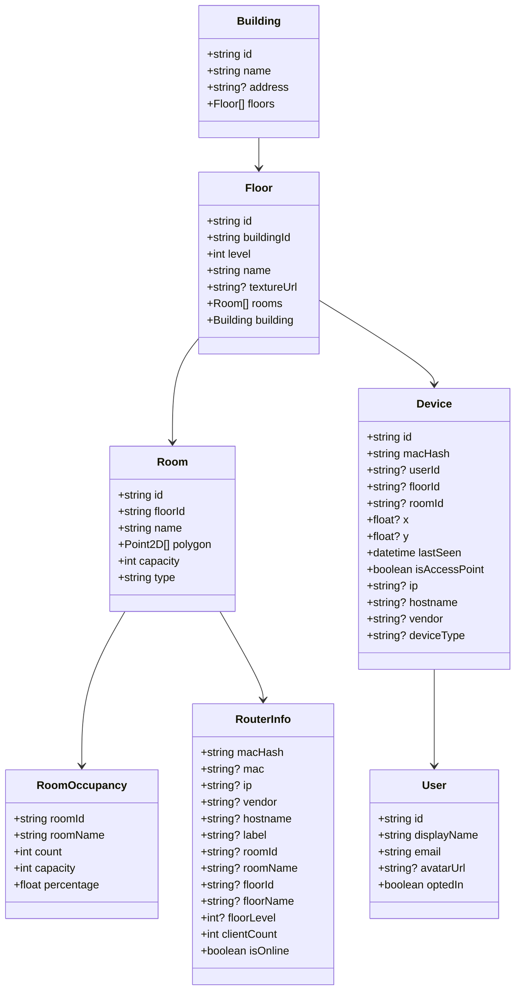

# EpiBat API Documentation

> **Base URL**: `http://localhost:4000`  
> **Interactive docs**: [http://localhost:4000/docs](http://localhost:4000/docs) (Swagger UI)  
> **OpenAPI JSON**: [http://localhost:4000/docs/json](http://localhost:4000/docs/json)

---

## Authentication

Most endpoints are **public**. Protected endpoints require a `Bearer` JWT token obtained from `POST /api/v1/auth/register`.

```
Authorization: Bearer <token>
```

### Auth Flow



---

## Endpoints Overview

### Health

| Method | Path | Description |
|--------|------|-------------|
| GET | `/health` | Server health check (status, uptime) |

### Auth

| Method | Path | Auth | Description |
|--------|------|------|-------------|
| POST | `/api/v1/auth/register` | — | Register a user for opt-in tracking |
| POST | `/api/v1/auth/optout` | Bearer | Opt out of tracking |
| GET | `/api/v1/auth/me` | Bearer | Get current user from JWT |

### Floors

| Method | Path | Description |
|--------|------|-------------|
| GET | `/api/v1/floors` | List all floors with rooms |
| GET | `/api/v1/floors/:id` | Get a single floor by ID |
| GET | `/api/v1/buildings` | List all buildings with their floors |

### Floor Plans

| Method | Path | Description |
|--------|------|-------------|
| POST | `/api/v1/floors/:id/plan` | Upload a floor plan (PDF/image, multipart) |
| DELETE | `/api/v1/floors/:id/plan` | Delete a floor plan |
| GET | `/api/v1/floors/:id/plan` | Get floor plan info for a floor |
| GET | `/api/v1/floors/plans` | List all floor plans |

### Rooms

| Method | Path | Description |
|--------|------|-------------|
| GET | `/api/v1/rooms` | List all rooms (optional `?floorId=`) |
| GET | `/api/v1/rooms/:id` | Get a room by ID |
| GET | `/api/v1/rooms/:floorId/occupancy` | Get room occupancy for a floor |
| POST | `/api/v1/rooms` | Create a room |
| PUT | `/api/v1/rooms/:id` | Update a room |
| DELETE | `/api/v1/rooms/:id` | Delete a room |

### Devices

| Method | Path | Description |
|--------|------|-------------|
| GET | `/api/v1/devices` | List active devices (optional `?floorId=`) |
| GET | `/api/v1/devices/search` | Search devices by `?q=` (hostname, MAC, vendor) |
| POST | `/api/v1/devices/link` | Link a device to a user |
| GET | `/api/v1/devices/counts` | Device count per floor |

### Routers

| Method | Path | Description |
|--------|------|-------------|
| GET | `/api/v1/routers` | List all routers / access points |
| PUT | `/api/v1/routers/:macHash` | Assign a router to a room / floor |
| DELETE | `/api/v1/routers/:macHash` | Remove a router assignment |
| POST | `/api/v1/routers/sync` | Sync detected APs to database |

### Scanner

| Method | Path | Description |
|--------|------|-------------|
| GET | `/api/v1/scanner/status` | Scanner status |
| POST | `/api/v1/scanner/scan` | Trigger a manual network scan |
| GET | `/api/v1/scanner/devices` | List discovered devices from last scan |
| GET | `/api/v1/scanner/access-points` | List detected access points |
| GET | `/api/v1/scanner/wifi` | Current WiFi connection info |

---

## Real-time Events (Socket.io)

Connect to the Socket.io server on the same host & port for live updates.



### Client → Server

| Event | Payload | Description |
|-------|---------|-------------|
| `floor:subscribe` | `floorId: string` | Subscribe to device updates for a floor |
| `floor:unsubscribe` | `floorId: string` | Unsubscribe from floor updates |
| `user:optin` | `{ token: string }` | Opt-in to personal tracking |

### Server → Client

| Event | Payload | Description |
|-------|---------|-------------|
| `devices:update` | `Device[]` | Batch device update for subscribed floor |
| `room:occupancy` | `RoomOccupancy[]` | Room occupancy changed |
| `device:moved` | `Device` | A device changed position |
| `device:entered` | `{ device, roomId }` | A device entered a room |
| `device:left` | `{ deviceId, roomId }` | A device left a room |

---

## Data Models

### Entity Relationship Diagram



### API Response Models



---

## Error Responses

All error responses follow the same shape:

```json
{
  "success": false,
  "error": "Description of the error"
}
```

Common HTTP status codes:

| Code | Meaning |
|------|---------|
| 200 | Success |
| 201 | Created (POST /rooms) |
| 400 | Bad request / validation error |
| 401 | Unauthorized (missing/invalid JWT) |
| 404 | Resource not found |
| 500 | Internal server error |
